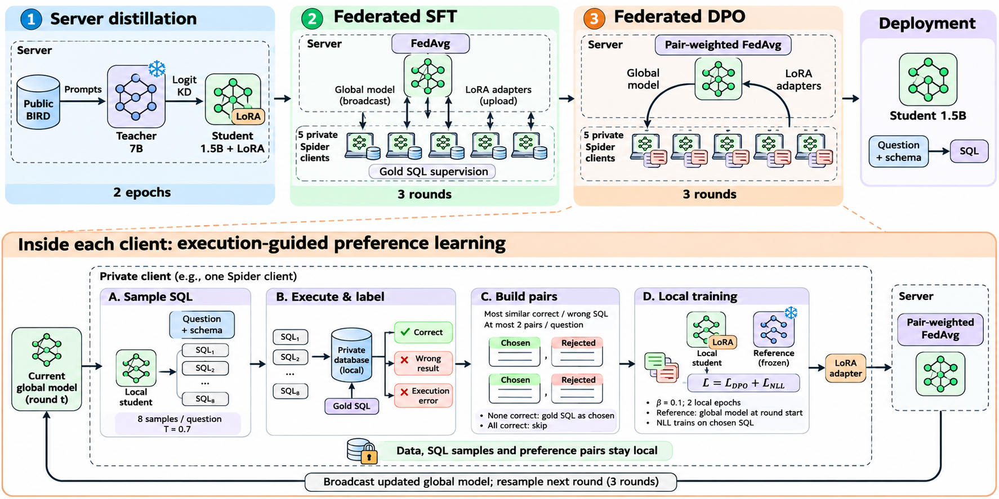

# FedLS-SQL: báo cáo tiến độ 11/11/2026

Thưa thầy,

Em gửi thầy kết quả mới và ba điểm em muốn xin ý kiến thầy.

**Method** dùng student Qwen2.5-Coder-1.5B train bằng LoRA, với 5 client
chia từ Spider train, gồm ba bước:

1. **Server KD:** distill logit từ teacher 7B trên BIRD public, 2 epoch.
2. **FedAvg SFT:** train trên câu hỏi và gold SQL của client, 3 round.
3. **Federated DPO:** mỗi client sample SQL, gán nhãn bằng execution trên
   database của mình, rồi train DPO + NLL trên cặp đúng/sai. Server gộp
   adapter theo số cặp; lặp 3 round, mỗi round sample lại từ model global mới.

Teacher chỉ chạy ở server. Client chỉ gửi adapter; data, sample và các cặp
ở lại client.

**Kết quả** trên Spider test:

| Cấu hình                  |        EX |        EM |
| ------------------------- | --------: | --------: |
| Base 1.5B zero-shot       |     57.89 |     31.11 |
| FedProx                   |     70.42 |     58.69 |
| FedAvg                    |     71.26 |     60.32 |
| Centralized Spider + BIRD |     73.96 |     65.07 |
| Method w/o DPO            |     73.31 |     64.42 |
| Method w/o server stage   |     75.13 |     62.93 |
| Method w/o teacher        |     75.22 |     64.97 |
| **Method**                | **76.71** | **65.49** |
|                           |           |           |
| _Teacher 7B zero-shot_    |   _77.22_ |   _46.48_ |

Method w/o DPO là bước 1 + 2; w/o server stage là bước 2 + 3; w/o teacher là
cả 3 bước nhưng bước 1 train bằng gold SQL của BIRD thay cho distill teacher.

EX trên các set khác:

| Cấu hình                | Spider dev | Realistic |       SYN |        DK |
| ----------------------- | ---------: | --------: | --------: | --------: |
| FedAvg                  |      67.89 |     58.86 |     53.77 |     52.15 |
| Method w/o DPO          |      72.82 |     62.01 |     56.67 |     58.13 |
| Method w/o server stage |      73.11 |     63.58 |     58.32 |     58.88 |
| Method w/o teacher      |      73.79 | **65.35** |     59.86 |     57.94 |
| **Method**              |  **76.50** |     64.17 | **61.03** | **64.11** |

- DPO là đóng góp chính: 3.4% EX trên Spider test khi có bước 1
  và 3.9 điểm khi không có. Không có bước 1, DPO vẫn tăng 4.6-6.7 điểm trên
  bốn set còn lại. Control (chỉ train trên câu đúng, hoặc SFT thêm round)
  không tạo ra mức tăng này. 3 round là đủ.
- Method hơn FedAvg 5.45 điểm EX trên Spider test, hơn bản centralized 2.75
  điểm, và gần bằng teacher 7B zero-shot (77.22).
- EM tăng ít hơn EX sau DPO (1.1 điểm khi có bước 1, 2.6 khi không có).
  Teacher zero-shot có EX cao nhất nhưng EM chỉ 46.48, vì chưa train trên
  Spider nên viết SQL khác dạng của gold.
- Mức tăng của DPO đến từ lỗi execution (SQL không chạy được, hầu hết do
  viết sai tên cột hoặc bảng): trên Spider test loại lỗi này giảm từ 129
  xuống 58 câu, trong khi SFT thêm round không giảm được nó. Số câu chạy được
  nhưng sai kết quả gần như không đổi (444 và 442 câu, khoảng 20% Spider
  test); DPO chưa sửa được nhóm này.
- CoT ở 1.5B kém SQL-only: sau DPO CoT chỉ đạt 70.89 EX trên Spider dev,
  SQL-only đạt 74.18 với cùng cách train. Em chỉ giữ CoT làm một phân tích
  ngắn.

**So với các paper liên quan:**

Gán nhãn sample bằng execution rồi train DPO đã có ở Text-to-SQL centralized.
Bài em khác ở hai điểm: làm việc này tại từng client trong federated learning
(client tự sample, tự gán nhãn trên database của mình, chỉ gửi adapter), và
cho thấy ở SLM 1.5B SQL-only DPO có tác dụng vì nó sửa lỗi execution, loại
lỗi model nhỏ còn nhiều sau SFT. So với từng hướng gần nhất:

- Federated Text-to-SQL: mới có [FL4SP](https://arxiv.org/abs/2305.17221)
  (T5-base, exact match), chỉ train trên gold SQL, và bản federated tốt nhất
  vẫn dưới centralized (62.6 so với 70.3 EM). Bài em dùng SLM 1.5B, đo bằng
  EX, và nhờ bước DPO mà hơn cả centralized SFT (76.71 so với 73.96).
- Federated DPO ([OpenFedLLM](https://arxiv.org/abs/2402.06954),
  [FedBiscuit](https://arxiv.org/abs/2407.03038)): dùng nhãn preference của
  người. Ở bài em nhãn đến từ execution, nên client tự tạo được cặp và tạo
  lại sau mỗi round từ model global mới.
- Federated RL có verifier ([PubSwap](https://arxiv.org/abs/2604.12160),
  [Fed-GRPO](https://arxiv.org/abs/2610.11502),
  [FedMOA](https://arxiv.org/abs/2602.00453)): gần bài em nhất về ý tưởng,
  cũng dùng reward tự động ở client, nhưng làm trên toán và code bằng GRPO và
  tập trung vào cách gộp model, giảm client drift. Bài em làm Text-to-SQL
  bằng DPO và giữ FedAvg thường.
- DPO cho Text-to-SQL, đều centralized:
  [CoT for DPO](https://aclanthology.org/2025.acl-long.1031/) và
  [ExCoT](https://arxiv.org/abs/2503.19988) (7B-70B) cũng gán nhãn sample
  bằng execution như bài em, và thấy SQL-only DPO làm EX giảm, phải có CoT
  thì DPO mới tăng (Qwen2.5-Coder-7B trên BIRD dev: SQL-only 61.6 xuống 61.3,
  CoT 60.8 lên 63.4).
  [SQLoom](https://arxiv.org/abs/2611.03298) (1.7B) không dùng CoT nhưng phải
  gọi GPT-4 trong lúc train. Ở 1.5B SQL-only DPO của em tăng 3.4-3.9 điểm EX
  mà không cần CoT hay GPT-4, và CoT sau DPO vẫn kém SQL-only. Hai kết quả
  không mâu thuẫn: mức tăng của em đến từ lỗi execution, loại lỗi SLM còn
  nhiều sau SFT (129 câu) còn model 7B thì ít (teacher 7B zero-shot của em:
  76 câu); với các câu sai kết quả, DPO của em cũng không sửa được, giống hai
  bài này. DPO của em khác CoT for DPO ở ba chỗ: kèm loss NLL, sample lại sau
  mỗi round (ExCoT cũng làm), và dùng gold SQL khi không có sample đúng (theo
  [Iterative RPO](https://arxiv.org/abs/2404.19733)).

**Em xin ý kiến thầy:**

1. Trọng tâm của bài. Tên FedLS-SQL và outline hiện tại xoay quanh việc
   distill từ LLM sang SLM, trong khi phần tạo ra kết quả là DPO. Em đề xuất
   đổi trọng tâm sang federated DPO với cặp gán nhãn bằng execution ở client,
   và đưa bước 1 xuống thành một phần phụ. Tên gợi ý: "Federated
   Execution-Guided Preference Optimization for Text-to-SQL with Small
   Language Models". Outline gợi ý: bài toán; method (FedAvg rồi federated
   DPO); kết quả và control; phân tích (loại lỗi được sửa, số round, bước
   server với teacher, CoT); hạn chế.
2. Phần teacher và BIRD. Data BIRD với gold SQL không còn tác dụng sau DPO
   (75.22 so với 75.13). Teacher giúp thêm 1.5 điểm trên Spider test, chưa rõ
   rệt, nhưng rõ trên Spider dev (+2.7) và DK (+6.2); hai set này dùng chung
   database. Sau DPO student đã gần bằng teacher (76.71 so với 77.22), nên em
   nghĩ phần teacher đóng góp là robustness hơn là EX. Thầy đánh giá mức này
   có đủ để giữ bước 1 trong method không, hay chỉ nên để ở phần ablation?
3. Phần bổ sung. Em định chạy thêm DPO centralized và DPO ở từng client không
   gộp, để thấy setting federated mất và được gì, rồi thêm một cách chia data
   client khác. Thầy thấy thứ tự này có hợp lý không?

**Tiếp theo:** seed thứ hai đang chạy, dự kiến xong sáng 13/11.

Em cảm ơn thầy ạ.
