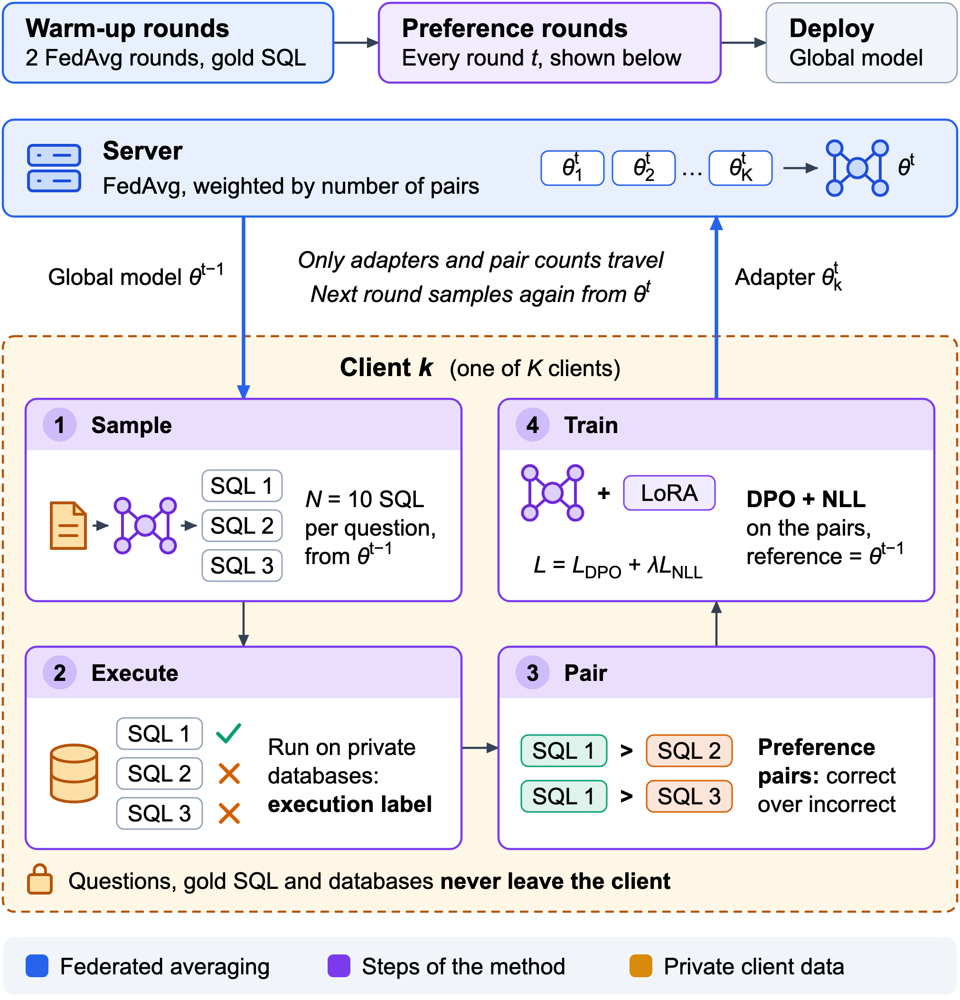

# Email: đề xuất đổi method, xin ý kiến Thầy

**Tiêu đề:** Xin ý kiến Thầy về đề xuất đổi method và experimental plan

Chào Thầy,

Em có ba đề xuất cho bài và xin ý kiến Thầy.

**Đề xuất 1: bỏ stage KD để method gọn hơn**

Stage knowledge distillation (KD) từ LLM teacher cho gain nhỏ so với
compute cost, trong khi client-side DPO cho gain lớn hơn với cost thấp
hơn. Em đo từng stage ở setup cũ, trên Spider test (pooled 2 seed), một
RTX A5000:

| Stage | EX gain | Compute cost |
| --- | ---: | --- |
| Public-data KD stage | +1.40 | teacher inference (7B) khoảng 14 GPU-hour (ước tính), KD training 3.3 đến 3.6 GPU-hour/epoch |
| Teacher supervision so với gold-SQL SFT | +0.98 (p = 0.04) | như trên |
| Client-side DPO | **+3.19 đến +3.91** | khoảng 3 GPU-hour/round |

Em đề xuất bỏ KD khỏi method, để làm future work. Method khi đó không
còn teacher.

**Đề xuất 2: method gồm SFT warm-up và on-policy DPO**

Method có hai stage: SFT warm-up bằng FedAvg (2 communication round),
sau đó là các on-policy DPO round. Ở mỗi DPO round, client sample N = 10
SQL candidate cho mỗi question từ global model, execute trên private
database để lấy execution label, rồi local training bằng DPO + NLL loss
trên các preference pair (SQL đúng so với SQL sai). Server aggregate các
LoRA adapter bằng FedAvg.

Hình 1. Method overview: SFT warm-up, sau đó là các on-policy DPO round
tại client; chỉ LoRA adapter được truyền giữa server và client.

Kết quả hiện có (EX; 5 client, non-IID partition, 4 communication
round):

| Benchmark | Backbone | Zero-shot | Centralized SFT | FedAvg SFT | Method | Gain vs. FedAvg SFT |
| --- | --- | ---: | ---: | ---: | ---: | ---: |
| BIRD dev | Qwen2.5-Coder-1.5B | 29.47 | - | 42.57 | **48.76** | +6.19 |
| Spider test | Qwen2.5-Coder-1.5B | 68.05 | 75.73 | 74.71 | **78.20** | +3.49 |
| Spider test | Qwen2.5-Coder-0.5B | 54.40 | - | 64.09 | **66.19** | +2.10 |
| Spider test | DeepSeek-Coder-1.3B | 55.85 | - | 69.82 (round 2) | **75.08** (round 3) | +5.26 |

Method cao hơn FedAvg SFT trên cả hai benchmark và ba backbone; với 1.5B
trên Spider test, method vượt cả centralized SFT.

Research gap: prior work về federated Text-to-SQL mới có một bài (Zhang
et al., ACL 2023: T5-base, SFT only). CodeLutra (TMLR 2025) có loop
sampling, execution feedback và DPO tương tự nhưng ở centralized
setting; em tìm thấy bài này sau khi thiết kế. Contribution đề xuất:
execution label được tạo tại từng client trên private database,
on-policy sampling theo từng communication round, với small language
model 1.5B.

**Đề xuất 3: experimental plan**

Main setup: 5 client, non-IID partition (Dirichlet α = 0.1), full
participation, LoRA fine-tuning, single seed; metric EX trên BIRD dev và
Spider test; significance bằng McNemar test với Holm correction. BIRD là
primary benchmark, Spider dùng cho các extended experiment.

| Nhóm | Thực nghiệm | Benchmark |
| --- | --- | --- |
| Baseline | Zero-shot; Local SFT; Centralized SFT; FedAvg SFT; FedProx SFT; FedDPO của OpenFedLLM (fixed preference pairs, fixed reference model, không NLL term) | BIRD, Spider |
| Ablation study | w/o on-policy sampling; w/o NLL term; w/o preference term; số SFT warm-up round k = 0, 2, 3; aggregation weight | BIRD, Spider |
| Backbone | Qwen2.5-Coder-0.5B, DeepSeek-Coder-1.3B | Spider; DeepSeek thêm trên BIRD |
| Federated setup | K = 5 với Dirichlet α = 0.1, α = 0.5, IID; K = 10 với α = 0.5 | Spider |
| Control | Pooled DPO (không aggregation); FedAvg SFT với nhiều communication round hơn; thêm một DPO round (trên BIRD) | Spider, BIRD |
| Robustness | Spider-Syn, Spider-Realistic, Spider-DK; test-suite accuracy | Spider |
| Analysis | Error analysis theo round; EX theo difficulty level; client update (số preference pair, cosine similarity); cost analysis | BIRD, Spider |

**Em xin ý kiến Thầy:**

1. Bỏ KD như Đề xuất 1 có hợp lý không ạ.
2. Research gap và contribution ở Đề xuất 2 có đủ cho một bài không ạ.
3. Experimental plan ở Đề xuất 3 đã đủ chưa, cần thêm hay bớt gì ạ.
4. Thầy đặt giúp em tên bài (working title: FedLS-SQL).

Em cảm ơn Thầy.
