# FedLS-SQL: hướng nghiên cứu

Cập nhật 2026-11-07. Chưa có kết quả nào kể từ fresh start; mọi GPU-h dưới
đây là ước lượng từ số đo của các job cùng loại (mục 7). Bản trước:
`archive/paper/directions_2026-11/DIRECTION_2026-11-07.md` (local) và Git
history.

## 1. Bài toán trong một đoạn

Năm client giữ dữ liệu Spider riêng, cùng train model Qwen2.5-Coder-1.5B bằng
FL, chỉ deploy model 1.5B. Server có thể dùng teacher Qwen2.5-Coder-7B (frozen)
và dữ liệu public. Mục tiêu: một method thắng rõ các baseline federated.

Hai quan sát định hướng:

- FedAvg SFT đã bằng SFT tập trung trên Spider test (71.50 so với 71.08), nên
  method sửa drift (FedProx, SCAFFOLD, aggregation mới) có ít chỗ để thắng.
  Phải đổi cái model học. Trên dev thì khác: FedAvg R3 thấp hơn tập trung 3.8
  điểm (67.60 so với 71.37).
- Text-to-SQL có verifier sẵn: client chạy SQL trên database của mình là biết
  đúng hay sai, không cần gửi dữ liệu đi đâu.

## 2. Method gồm ba lựa chọn

Một method của paper = **cách client train** + **việc server làm thêm** +
**thời điểm server làm**. Mỗi phần có vài lựa chọn (mục 3, 4, 5); mục 6 chọn
thứ tự thử.


Hình trên là tổ hợp đề xuất trước research: client DPO + NLL, server KD
on-policy có cổng (S2), chạy sau mỗi vòng. Research ở mục 6 xếp S5 (CoT) lên
trước S2.

## 3. Cách client train

| | Lựa chọn | Làm gì | Vai trò |
|---|---|---|---|
| C1 | DPO + NLL bằng execution | Model sinh 8 SQL mỗi câu, chạy trên database riêng, học ưu tiên câu đúng hơn câu sai | Ứng viên method |
| C2 | RFT | Như C1 nhưng chỉ SFT trên các sample đúng, bỏ câu sai | Đối chứng: câu sai có giúp không |
| C3 | SFT thêm vòng | FedAvg SFT bình thường, thêm vòng | Baseline chính |
| C4 | DPO theo clause | Như C1, nhưng chạy SQL từng clause (FROM, WHERE, GROUP BY...) để biết sai ở clause nào, rồi tăng trọng số token ở đó | Nâng cấp C1, thử sau round 1 (mục 6) |

Chưa chốt. Round 1 trong `PIPELINE_NEXT.md` chạy cả ba từ cùng điểm xuất phát
(FedAvg R3) và quyết định:

- C1 hơn C2 và C3: giữ C1.
- C2 bằng C1: client dùng C2 vì đơn giản hơn.
- Cả hai không hơn C3: phía client không có method; phần server phải gánh cả
  paper.



Chi tiết C1:

1. Mỗi vòng, client lấy một phần câu hỏi của mình (400 câu), sample K=8 SQL ở
   T=0.7 từ model global.
2. Chạy từng SQL so với gold trên database riêng. SQL chỉ tính là đúng khi
   cũng khớp gold trên vài bản database đổi giá trị (cách sinh database của
   test-suite, Zhong et al. 2020), để giảm "đúng giả".
3. Chọn cặp: chosen là SQL đúng (dùng gold nếu không sample nào đúng);
   rejected ưu tiên SQL chạy được nhưng ra kết quả sai, rồi mới tới SQL lỗi.
4. Train DPO + NLL 2 epoch, reference là model global của vòng đó, gửi LoRA.
5. Server FedAvg theo số cặp. Vòng sau sample lại từ model mới.

Paper gần nhất: Iterative RPO (tập trung, toán), ExCoT (tập trung, SQL,
32-70B, có CoT), FedDPO trong OpenFedLLM, FedBiscuit, Fed-GRPO. Điểm phải đối
mặt: Liu et al. (ACL 2025) và ExCoT thấy DPO SQL-only không giúp ở 6.7B trở
lên; ở 1.5B chưa ai đo.

## 4. Việc server làm thêm

### 4.1 Vì sao cần bước server

C1 chỉ biến cái model đã biết (pass@8) thành câu trả lời greedy. Muốn nâng
trần đó phải thêm kiến thức mà dữ liệu client không có: dữ liệu public và
teacher ở server. Nếu server chỉ train giống client trên dữ liệu public, nó
chỉ là "client thứ 6"; bước server nên dùng thứ chỉ server có: teacher, gold
public, adapter của mọi client, compute tập trung.

Teacher không dùng để sửa câu student viết sai: teacher chỉ khớp gold trên
5,319 / 9,428 câu BIRD train (56%), và server đã có gold.

### 4.2 Dữ liệu ở server

Owner cho phép dùng BIRD hoặc SynSQL (2026-11-07), chọn theo cái hợp với lựa
chọn server hơn.

| | BIRD train (có evidence) | SynSQL-2.5M (OmniSQL, Apache-2.0) |
|---|---|---|
| Quy mô | 9,428 câu, 69 database | 2.5M câu, 16,583 database (có sẵn trên máy); pool đã lọc 3,336 câu trên 3,027 database, lấy thêm được |
| Giống Spider ở đâu | Database thật, giá trị thật | Nhiều database và nhiều domain như Spider; không có evidence |
| Khác Spider ở đâu | Có evidence, prompt dài, SQL khó hơn | Câu hỏi sinh tự động, nhiều kiểu văn phong; database chỉ khoảng 2 dòng mỗi bảng |
| Có sẵn từ teacher | SQL teacher (5,319 câu khớp gold), logit cache trên gold, 1,266 CoT đã kiểm | Chưa có; dataset kèm sẵn CoT |
| Nhãn bằng execution | Tin được | Yếu: database quá ít dòng nên SQL sai vẫn dễ ra cùng kết quả |
| Paper dùng | OmniSQL, SQLoom, ExCoT, Think2SQL, Reasoning-SQL | OmniSQL, SLM-SQL, SQL-R1, CAPER, EXPO-SQL |

### 4.3 Các lựa chọn

| | Server làm gì | Teacher | Chỉ server có |
|---|---|---|---|
| S0 | Không làm gì, chỉ FedAvg | Không | |
| S1 | KD offline: student bắt chước xác suất từng token của teacher trên SQL có sẵn | Có | Teacher |
| S2 | KD on-policy có cổng: student tự viết SQL, teacher chấm từng token, chỉ dùng câu mà SQL teacher khớp gold | Có | Teacher |
| S3 | DPO bằng execution trên dữ liệu public, giống C1 | Không | Gold public |
| S4 | Cho 5 adapter client cùng viết SQL trên dữ liệu public, giữ câu đúng, model global học từ đó | Không | Adapter mọi client |
| S5 | Teacher viết CoT ngắn, student học suy luận rồi mới viết SQL | Có | Teacher |

**S1. KD offline.** Loss là KL giữa phân phối token của student và teacher
trên chuỗi SQL cố định (gold hoặc SQL teacher). Trên BIRD, logit cache đã có;
một epoch 9,428 dòng mất 3.3-3.6 h. Paper: KID (SQL, 1B: reverse-KL KD hơn SFT
khoảng 2 điểm), MiniLLM, FedCoLLM.



**S2. KD on-policy có cổng execution.** Model global sinh SQL; teacher chấm
log-prob từng token trên SQL của student và trên SQL đúng; loss kiểu
DistiLLM-2 (kéo lên ở SQL đúng, đẩy xuống ở token student mà teacher cho là
khó xảy ra). Cổng: chỉ dùng câu mà SQL teacher khớp gold. Client có tín hiệu
thưa (cả câu đúng hay sai), server có tín hiệu dày (sai ở token nào). Student
train trên BIRD đã chiếm khoảng 20 GiB nên teacher chấm ở card còn lại, theo
từng vòng. Paper: DistiLLM-2 (đúng cặp Coder 7B → 1.5B, code: HumanEval 30.7
→ 42.2), GKD, KID, SERL-SQL, FedCoLLM.



**S3. DPO bằng execution trên dữ liệu public.** Như C1 nhưng ở server. Bản
GRPO online quá đắt; bản DPO trên tập con khoảng 2,000 câu BIRD tốn khoảng
5-8 h phần sample. Bằng chứng chuyển BIRD → Spider mạnh nhất trong các lựa
chọn (Think2SQL 3B: 72.5 → 77.0).


**S4. Chưng cất từ ensemble adapter client.** Kiểu FedDF với chọn output bằng
execution. Không cần teacher. Các adapter đều train trên Spider nên có thể ít
khác nhau.


**S5. CoT ngắn từ teacher.** Teacher viết lời giải từng bước trên dữ liệu
public, student SFT rồi client DPO trên cả chuỗi. Inference chậm khoảng 6.6
lần; đổi setup SQL-only ở client. Paper: Liu et al. ACL 2025, ExCoT,
Struct-SQL, OmniSQL.



## 5. Thời điểm server làm

| | Khi nào | Ai làm vậy | Ưu | Nhược |
|---|---|---|---|---|
| Trước FL | Một lần, trước các vòng client | GPT-FL | Rẻ, ablation sạch | Đóng góp một lần, dễ bị quên; nếu thắng, đóng góp chỉ là "khởi tạo tốt hơn", không còn gì federated |
| Sau mỗi vòng | Sau FedAvg, trước khi gửi model xuống | FedCoLLM, FedBiOT, FedBiscuit | On-policy đúng model vừa aggregate; phần server thành một phần của FL | Thêm thời gian mỗi vòng |
| Song song | Server là participant thứ 6 trong FedAvg | FedAuto | Không thêm thời gian tuần tự | Trọng số server là hyperparameter; dữ liệu public nhiều nên dễ lấn át |

Một lần sau FL bị loại: model deploy cho client sẽ bị dữ liệu public định hình
sau cùng.



## 6. Thứ tự thử (research 2026-11-07)

### 6.1 Kết luận

Với SQL-only, greedy EX trên Spider, chưa lựa chọn nào trong S1-S4 có bằng
chứng sẽ thắng cả C1 đứng một mình lẫn "SFT trên cùng dữ liệu public" từ 2
điểm trở lên:

- Các mức tăng KD lớn được công bố đều đến từ teacher train trên cùng domain
  (KID) hoặc student là base model yếu. DistiLLM-2: student 1.5B sau KD đạt
  42.2 HumanEval, trong khi bản Instruct gốc đã đạt 70.7.
- Train thêm trên BIRD khi student đã thấy Spider chỉ thêm khoảng 1 điểm
  Spider (SLM-SQL 1.5B: RL trên BIRD +0.6 Spider dev). SFT gold BIRD có thể
  hạ Spider (Reasoning-SQL 7B: 77.9 → 68.1).
- Ở model nhỏ, KD on-policy gần bằng KD offline (ablation của DistiLLM-2,
  KID). Loại loss quan trọng hơn: forward KL gần bằng SFT; reverse hoặc skew
  KL mới hơn.

S5 (CoT) có bằng chứng mạnh nhất, khi đi cùng client train bằng execution trên
CoT:

- Liu et al.: DPO chỉ giúp khi có CoT (+2.6 ở 7B).
- OmniSQL 7B: CoT hơn SFT gold 5.9 điểm Spider test.
- Đây cũng là lựa chọn mà phần federated làm việc thật: client kiểm lời giải
  trên database riêng.
- Cái giá: inference chậm khoảng 6.6 lần, bỏ setup SQL-only.
- Research riêng về CoT (mục 6.5) hạ kỳ vọng: CoT SFT một mình thường không
  hơn SQL-only; mức tăng chỉ có sau các vòng kiểm bằng execution.

Với C1 (SQL-only), bằng chứng hiện có dự đoán thêm tối đa khoảng 1 điểm: Liu
et al. thấy DPO hại 6/10 model từ 6.7B, SENSE +0.2 đến +0.9 Spider dev, ExCoT
thấy DPO SQL-only dưới SFT. Kết quả dương duy nhất ở 1.7B (SQLoom) cần loss
giới hạn theo token và negative do GPT-4 viết. Round 1 vẫn là thí nghiệm quyết
định.

Thời điểm server làm (sau mỗi vòng hay một lần trước FL): chưa paper LLM nào so
hai cách này, nên phải tự đo.

Lưu ý: "drift không đáng kể" chỉ đúng trên test. Trên dev, FedAvg R3 thấp hơn
SFT tập trung 3.8 điểm (67.60 so với 71.37).

### 6.2 Đánh giá từng lựa chọn

| Lựa chọn | Khả năng thắng 2 điểm | Câu chuyện nếu thắng | Đề xuất |
|---|---|---|---|
| S1 trên BIRD (cache forward KL có sẵn) | Thấp: KID forward KL 57.3 so với SFT 57.8 Spider dev, dù teacher cùng domain | Yếu, giống FedCoLLM | Chỉ làm baseline KD |
| S1 trên SynSQL (reverse/skew KL) | Thấp-trung bình: reverse KL hơn SFT 3-5 điểm ở KID nhưng đó là cùng domain | Trung bình | Một arm trong probe KD |
| S2 trên BIRD | Thấp: BIRD chuyển sang Spider kém; on-policy gần bằng offline | Tốt (tín hiệu dày ở server, thưa ở client) | Để sau, chỉ khi bản SynSQL thắng |
| S2 trên SynSQL | Thấp-trung bình: SynSQL giống Spider hơn, nhưng OmniSQL chỉ thêm +1.2 dev / +1.3 test ở 7B với SynSQL; cổng execution yếu trên database 2 dòng | Như trên | Thử đầu tiên trong nhóm KD, sau cổng teacher |
| S3 trên BIRD | Thấp trên Spider; có thể tăng BIRD dev | Yếu: "client thứ 6" | Để sau, chỉ khi BIRD dev thành số chính |
| S3 trên SynSQL | Rất thấp: database 2 dòng nên SQL sai hay ra trùng kết quả; Arctic thấy SynSQL "inconclusive" | | Bỏ |
| S4 | Rất thấp: client không drift trên test nên 5 adapter gần như giống nhau; BIRD 26% nên ít output được giữ; thực chất thành RFT trên public data | Cơ chế FedDF (gộp model khác nhau) không có ở đây | Bỏ |
| S5 + client train trên CoT | Trung bình: Liu et al. CoT+DPO 63.4 so với DPO SQL-only 61.3 (7B BIRD); Struct-SQL 4B 34.3 → 45.0; ở 1.5B bằng chứng còn mỏng | Tốt nhất: teacher dạy suy luận trên public data, client kiểm suy luận trên database riêng. Gần nhất: ExCoT, Liu et al. (tập trung), FedCoT (teacher thấy dữ liệu client, ta thì không) | Thử đầu tiên |
| C4 (mới): DPO có trọng số theo clause ở client (EXPO-SQL, Focused-DPO) | Trung bình, nếu C1 đã tăng 0.5-2 điểm: Focused-DPO +1-3 so với DPO; CAPER clause +1.1 Spider test | Trả lời câu reviewer "sao không chỉ ra lỗi ở đâu"; chạy ở client nên federated tự nhiên | Thử sau kết quả round 1 |

### 6.3 Thứ tự

**Bước 0. Kiểm khoảng trống (khoảng 2 GPU-h, chạy cùng round 1).**
- Teacher 4-bit greedy trên Spider dev với prompt của project: khoảng 0.25 h.
- R3 pass@8 trên Spider dev, T=0.7: khoảng 1-2.4 h.
- Teacher hơn R3 (67.60) dưới khoảng 4 điểm: dừng nhóm KD (S1, S2).
  OmniSQL báo teacher đạt 73.4 dev ở bf16; con số ở 4-bit với prompt của ta
  có thể khác.
- Pass@8 trừ greedy là trần của C1.

**Bước 1. Probe CoT (khoảng 20 GPU-h, khoảng 10 h wall trên hai card).**
Thiết kế CoT ở mục 6.5. Mọi arm xuất phát từ R3, eval greedy Spider dev batch
16; S0 dùng lại arm C3 của round 1.

| Arm | Các bước | GPU-h (ước lượng) |
|---|---|---|
| A_srv | Server SFT trên 2k query plan của teacher (BIRD) | 1.3 + eval 1 |
| B_srv | Server SFT trên SQL gold của cùng 2k câu | 0.6 |
| T0 | Không bước server; client một vòng SFT trên query plan sinh từ gold SQL của mình | 2.4 + 1 |
| A1 | A_srv, rồi vòng client như T0 | 2.4 + 1 |
| A2 | A_srv, rồi vòng client SQL-only, eval ở chế độ CoT | 1.7 + 1 |
| A3 | A_srv, rồi vòng client CoT-RFT (200 câu mỗi client, K=4, giữ chuỗi có SQL đúng) | 2.9 + 0.8 + 1 |
| B1 | B_srv, rồi vòng client SQL-only | 1.7 + 0.2 |

Đọc kết quả:

- max(T0, A1, A3) trừ max(S0, B1) từ 2.0 trở lên: đi tiếp CoT. Từ 1.0 đến
  2.0: chạy thêm một vòng A3 (khoảng 6 GPU-h) rồi mới quyết. Dưới 1.0: dừng
  CoT. Mức 2.0 khoảng 2 sai số chuẩn trên 1,034 câu ghép cặp.
- A1 hoặc A3 trừ T0 dưới 1.0: teacher không đóng góp đo được; câu chuyện
  thành CoT chỉ ở client, không teacher.
- A2 thấp hơn A1 từ 1 điểm: client bắt buộc train trên CoT.
- Dừng sớm: tỉ lệ output đúng format của A_srv dưới 95%.

**Bước 2. Probe KD trên SynSQL (khoảng 15-18 GPU-h, chỉ khi bước 0 qua).**
- Mọi arm xuất phát từ R3, cùng 3k câu SynSQL:
  - (a) SFT gold;
  - (b) KD offline reverse/skew KL trên gold, dùng top-k logit teacher;
  - (c) DistiLLM-2 on-policy theo batch: một sample student mỗi câu, teacher
    chấm cả SQL student lẫn SQL gold.
- Eval ngay sau bước server: greedy dev và pass@8 dev. Đây là phép kiểm giả
  thuyết "server nâng trần pass@k".
- Sau đó chạy một vòng C3 cho mỗi arm, eval greedy lại.
- Số quyết định: arm KD tốt nhất sau vòng client hơn max(S0, a) từ 2.0 điểm
  greedy dev trở lên, đồng thời pass@8 cũng tăng từ 2 điểm. Tăng dưới 1 điểm
  thì dừng nhóm KD.
- Chỉ khi thắng mới so "sau mỗi vòng, 3 vòng" với "một lần trước FL".

**Bước 3. C4 sau kết quả round 1.** Không tốn GPU thêm cho phần chấm clause
(chạy CPU).

### 6.4 Owner cần quyết

- CoT lúc inference: owner chấp nhận (2026-11-07), với điều kiện chi phí khả
  thi (mục 6.5).
- Đồng ý bỏ S3 trên SynSQL và S4.

### 6.5 Thiết kế CoT (research 2026-11-07)

Kỳ vọng: CoT SFT một mình nhiều khả năng không hơn SQL-only. Ở 7B, trên
Spider dev greedy, CoT SFT thấp hơn SQL-only SFT 0.7-2.6 điểm (Liu et al.);
CoT chỉ vượt sau DPO bằng execution, và vượt ít (0.5-0.7 điểm trên SQL-only
SFT). ExCoT 70B: CoT SFT 81.4 so với SQL-only 83.0 Spider test, lên 86.6 sau 3
vòng DPO. Chưa có số greedy Spider nào ở 0.5B-3B so CoT với SQL-only. Nếu có
mức tăng 2 điểm, nó phải đến từ các vòng client kiểm CoT bằng execution.

**Format: query plan có cấu trúc (Struct-SQL, `qp_cot_v1`), giới hạn 512
token.** Struct-SQL (Qwen3-4B, BIRD mini-dev): SQL gold 34.3, CoT tự do 36.9,
query plan 45.0. Model nhỏ hợp với chuỗi ngắn (Li et al.: 1.5B, CoT ngắn 34.2
so với dài 27.0, toán). Format này đã có đủ trong code: prompt, giới hạn 1,024
token và parse chặt (output sai format tính EX 0).

**Nguồn: query plan của teacher trên BIRD, có sẵn 4,109 câu**
(`fedicl-sql/processed_data/protocol_v2/rationale_kd/p215_struct_full_s0/`).
Teacher viết không thấy gold SQL, câu được giữ khi kết quả chạy khớp gold
trên database BIRD thật; plan dài trung vị 249 token, p95 381. CoT có sẵn của
SynSQL không hợp: do model khác viết khi đã thấy SQL đáp án, chỉ kiểm trên
database 2 dòng, dài hơn (trung vị 428 token sau khi cắt).

**Client cũng train trên CoT.** Nếu client giữ SQL-only, mỗi vòng FedAvg kéo
model về format SQL-only. Chưa paper federated nào đo điều này; arm A2 đo nó.
Hai cách cho client:

- Rẻ nhất: query plan sinh tự động từ gold SQL của chính client
  (`sql_to_qp_cot`, cùng format với plan của teacher), không cần sample.
- On-policy: sample K=4, T=0.7 trên 200-300 câu mỗi client, chạy SQL, giữ một
  chuỗi đúng mỗi câu (RFT); câu không giải được dùng plan sinh từ gold. Vòng
  2-3 thêm DPO + NLL trên cặp đúng/sai gần nhau.

**Prompt: một template cho server SFT, client sample và eval** (`qp_cot_v1`,
instruction của Struct-SQL). Schema dạng DDL, câu hỏi, mục Hint (BIRD điền
evidence, Spider và SynSQL điền NONE), output là `**Query Plan**:` rồi
`## SQL Query:`. OmniSQL, SLM-SQL và Struct-SQL đều train và test bằng một
template. Struct-SQL: model CoT tự do chấm bằng prompt query plan tụt từ 36.9
xuống 29.2.

**Chi phí (ước lượng):**

| Việc | GPU-h |
|---|---|
| Eval CoT Spider dev / test | 0.7-1.2 / 1.4-2.6 |
| Client sample CoT, K=4, 300 câu mỗi client | khoảng 4.3 mỗi vòng |
| Vòng client SFT trên plan sinh từ gold | 2.1-2.7 |
| Server SFT CoT, 2k câu | khoảng 1.3 |
| Cả paper (method 3 vòng × 3 seed, baseline SQL-only, ablation CoT, eval độ bền) | khoảng 230-330, tức 5-7 ngày trên hai card |

Giảm chi phí: giới hạn 512 token (p95 của plan là 381-456 nên ít chuỗi bị
cắt), K=4, 200-300 câu mỗi client mỗi vòng, dùng plan sinh từ gold thay cho
sample ở vòng đầu.

**Phép so reviewer sẽ đòi:** 1.5B CoT so với 7B SQL-only (độ chính xác, token
mỗi câu, latency, bộ nhớ) và so với 1.5B SQL-only majority vote cùng số token
(khoảng 8 sample SQL cho một chuỗi CoT). Trên card của ta, 7B 4-bit SQL-only
mất 0.77-0.83 s mỗi câu ở batch 16, còn 1.5B CoT mất 2.4-4.3 s, nên lý do
deploy 1.5B phải dựa vào kích thước model và latency batch 1 (chưa đo).

Việc code còn thiếu: `short_cot.py` và `omnisql_cot.py` chưa có response
format trong `contracts.py`; eval sẽ chạy chúng như SQL-only (256 token, lấy
block đầu), nên chỉ dùng `qp_cot_v1`.

Bằng chứng và link: `LITERATURE.md` mục 1.7.

## 7. Số đo chi phí

GPU-h trên một card A5000; hai card chạy hai lane song song. Nguồn:
`fedicl-sql/docs/A5000_RUN_CONFIG.md`.

| Job | Số đo |
|---|---|
| Một vòng FL SFT, 5 client, 8,659 dòng Spider | 1.6-1.7 h |
| Eval SQL-only Spider dev, batch 16 | 0.07-0.3 h |
| Sample K=8 cho DPO (Spider) | 300 dòng trong 0.3-0.7 h |
| Update DPO + NLL | 0.4-0.9 h mỗi vòng (cặp từ khoảng 300 dòng) |
| CE trên BIRD gold, 9,428 dòng, 1 epoch | 2.7 h, khoảng 20 GiB |
| KD từ logit cache BIRD, 9,428 / 5,193 dòng | 3.3-3.6 h / 2.17 h |
| SFT trên CoT ngắn, 2,132 dòng | 1.3 h |
| Teacher sinh CoT ngắn trên BIRD, 4-bit batch 8 | 7.0-7.2 s mỗi output |
| Teacher sinh CoT trên SynSQL, 1,024 token | 13-18 s mỗi output |
| Eval CoT so với SQL-only | khoảng 6.6 lần chậm hơn |

Chưa đo: tốc độ và bộ nhớ khi teacher chấm từng token trên prompt BIRD; sample
K=8 trên BIRD (prompt dài hơn Spider, ước lượng 1.5-3 lần); thời gian CPU để
chạy 50-100k SQL gán nhãn mỗi vòng.

## 8. Baseline và metric

Baseline: zero-shot student; teacher zero-shot (tham khảo); mỗi client train
riêng; FedAvg SFT (cùng vòng và cùng GPU-h); FedProx; FedOPT + Lorar (FL4SP);
SFT tập trung; RFT (C2); DPO offline (không sample lại); method chạy tập
trung; SFT thêm dữ liệu public (đối chứng cho mọi lựa chọn server).

Metric: EX greedy trên Spider test (batch 16) là số chính; Spider dev (EX và
test-suite) để chọn cấu hình; Spider-Realistic, SYN, DK cho độ bền; BIRD dev
khi server dùng BIRD. Kèm số cặp mỗi client, GPU-h và dung lượng truyền mỗi
vòng, kết quả theo độ khó. Ba seed cho arm chính, gộp seed bằng kiểm định theo
cụm câu hỏi.

Ngân sách cả paper với C1 (ước lượng): 200-450 GPU-h, khoảng 4-10 ngày trên
hai card.

## 9. Quyết định của owner

- 2026-11-06: chạy C1 trước, không teacher. Teacher là tuỳ chọn. Dùng lại
  adapter FedAvg SFT `p227_fl_aaa_s0` (R3) làm baseline và điểm xuất phát.
- 2026-11-07: thêm phần server vào hướng nghiên cứu; dữ liệu server có thể là
  BIRD hoặc SynSQL.

Tên cũ trong bản trước: Hướng 1 = C1; Hướng 2 ≈ S5; Hướng 3 ≈ S3 (có thêm
chosen từ teacher); Hướng 4 ≈ S2 (chưa có cổng); cách đặt A, B, C = song song,
sau mỗi vòng, trước FL.

## 10. Diagram

Nguồn Mermaid (`.mmd`) và SVG trong `figures/`. Ô màu cam là bước chính của
mỗi hình. Sửa file `.mmd` rồi render lại từ thư mục `figures/`:

```bash
for f in *.mmd; do npx -y -p @mermaid-js/mermaid-cli@11.4.2 mmdc -q -i "$f" -o "${f%.mmd}.svg" -c mermaid.config.json -b white; done
```
